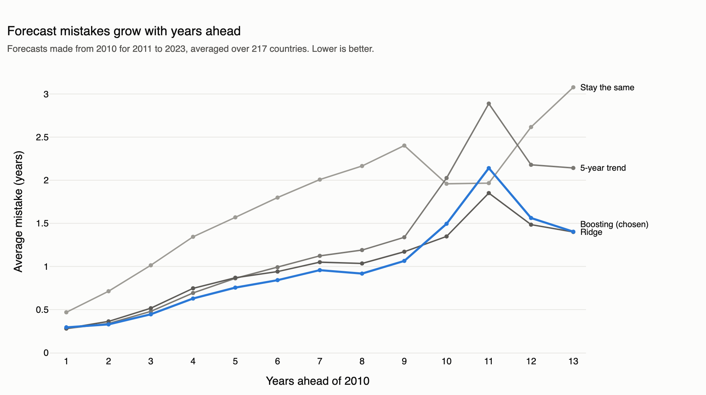
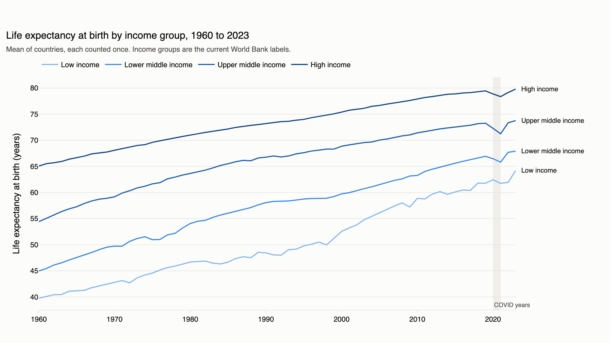
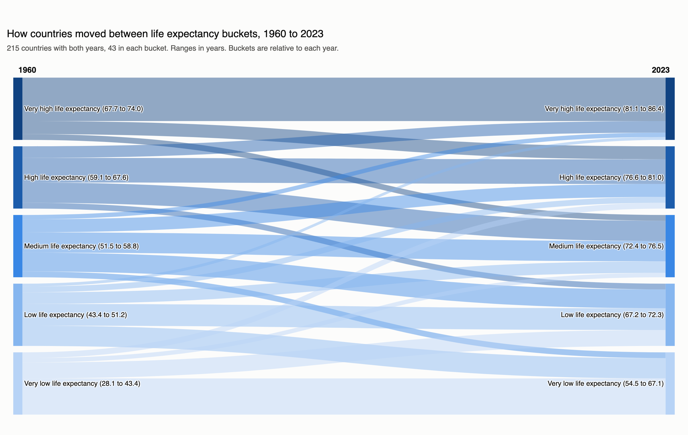
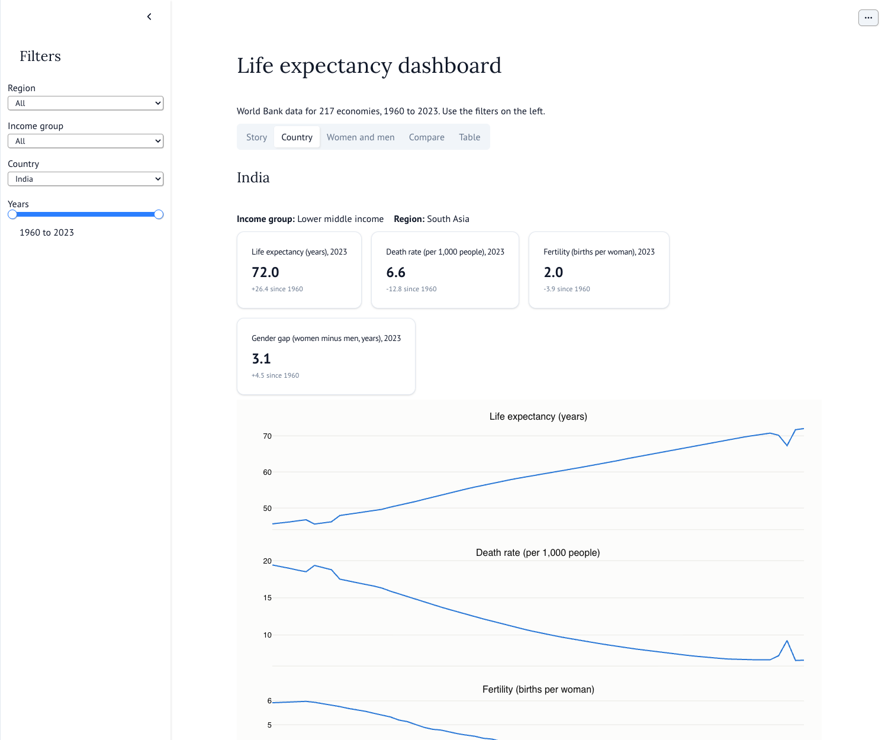

# Life expectancy at birth, 1960 to 2023

A Python project that analyses World Bank data for 217 economies. It answers three statistics questions, draws three required charts, forecasts life expectancy for 2011 to 2023 using only data up to 2010, and provides a filterable dashboard.

**The full answers, charts, and caveats are in [reports/findings.md](reports/findings.md).**

## Run it

You need [uv](https://docs.astral.sh/uv/) and `make`. uv installs Python 3.12 and the exact package versions from `uv.lock`.

```bash
uv sync --locked
make app
```

`make app` opens the dashboard in your browser. The data and results are already in the repository, so this works straight after cloning. The maps need internet access, because Plotly downloads the country shapes.

To rebuild every result and run the tests:

```bash
make all
make test
```

`make all` needs internet access and Google Chrome, which Plotly uses to save the PNG charts. It does not download the data again. To fetch the latest World Bank data, run `make download`, but note that newer data can change the results.

| Command | What it does |
| --- | --- |
| `make download` | Downloads the raw data from the World Bank API |
| `make data` | Builds the main table from the saved raw data |
| `make stats` | Answers the three statistics questions |
| `make figures` | Draws the charts |
| `make forecast` | Runs the forecasts and scores them |
| `make notebooks` | Exports the notebooks to HTML |
| `make test` | Runs the tests |
| `make app` | Opens the dashboard |

To explore the results interactively:

```bash
uv run marimo run notebooks/01_statistics.py
uv run marimo run notebooks/02_charts.py
uv run marimo run notebooks/03_forecast.py
```

### Open the notebooks in molab

[molab](https://molab.marimo.io) is marimo's free cloud service. These links show each notebook with its saved results, with no installation or login.

| Notebook | Link |
| --- | --- |
| Statistics: the three questions | [](https://molab.marimo.io/github/Samikshya-mohanty/nxp_data_scientist/blob/main/notebooks/01_statistics.py) |
| Charts: line chart, world map, and Sankey diagram | [](https://molab.marimo.io/github/Samikshya-mohanty/nxp_data_scientist/blob/main/notebooks/02_charts.py) |
| Forecast: practice exams and final score | [](https://molab.marimo.io/github/Samikshya-mohanty/nxp_data_scientist/blob/main/notebooks/03_forecast.py) |

The molab preview is read-only. molab copies only the notebook file, and these notebooks import code from `src/` and read data from this repository, so they cannot run there. To run them, use the commands above.

## Results

### Statistics

| Question | Answer |
| --- | --- |
| Income group whose gap between women's and men's average life expectancy changed most, 1960 to 2023 | **Upper middle income**, +1.67 years (from 4.26 to 5.93) |
| Income group whose variability in life expectancy changed most, 1960 to 2023 | **Upper middle income**, standard deviation from 7.55 to 3.78 years |
| Highest correlation between fertility and life expectancy | **India**, -0.9973 |
| Lowest correlation between fertility and life expectancy | **Belarus**, +0.0204 |

Averages count each country once. The first answer depends on that choice: with population weights, lower middle income changes most. A strong correlation here does not show cause, because both series follow long-term trends.

### Forecast

Using only data up to 2010, the chosen model, gradient boosting, was off by **0.99 years** on average for 2011 to 2023. Repeating the 2010 value was off by 1.78 years. Ridge regression was almost tied, at 1.00 years. The model was chosen on earlier practice years before the final score was calculated. The largest mistakes come from wars and crises, and from COVID in 2020 and 2021.



### Charts





### Dashboard



The dashboard filters by region, income group, country, and years. It shows life expectancy, death rate, fertility, and the difference between women and men, with a world map and comparisons by country, income group, or region.

## How the code is organized

```text
src/scripts/   code you run: fetch.py, panel.py, stats.py, figures.py, forecast.py
src/common/    shared code: paths, statistics, chart styles, and charts
src/ml/        the forecast models and scoring
app/           the dashboard
notebooks/     marimo notebooks that display the results
tests/         automated tests
data/raw/      the World Bank data as downloaded
data/processed/  the cleaned table, one row per country and year
reports/       findings, result tables, charts, and notebook exports
```

## Known limits

- Income groups are the World Bank's current labels, applied to every year.
- Group averages count each country once and are not weighted by population.
- The World Bank data was downloaded on 2026-11-04, with a last update of 2026-10-08.
- Historical values come from UN estimates that were revised later, so a forecast made in 2010 with the data available then would probably have done worse.
- Central African Republic has unexplained drops in 2009 and 2022. The reported values are kept.

## Data source

[World Bank Open Data](https://data.worldbank.org/): life expectancy at birth (total, male, and female), crude death rate, and total fertility rate.
