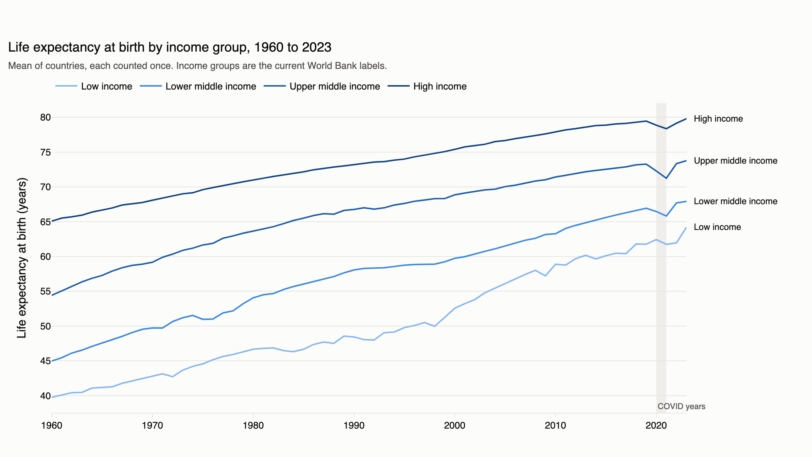
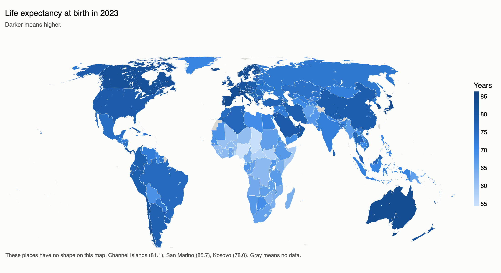
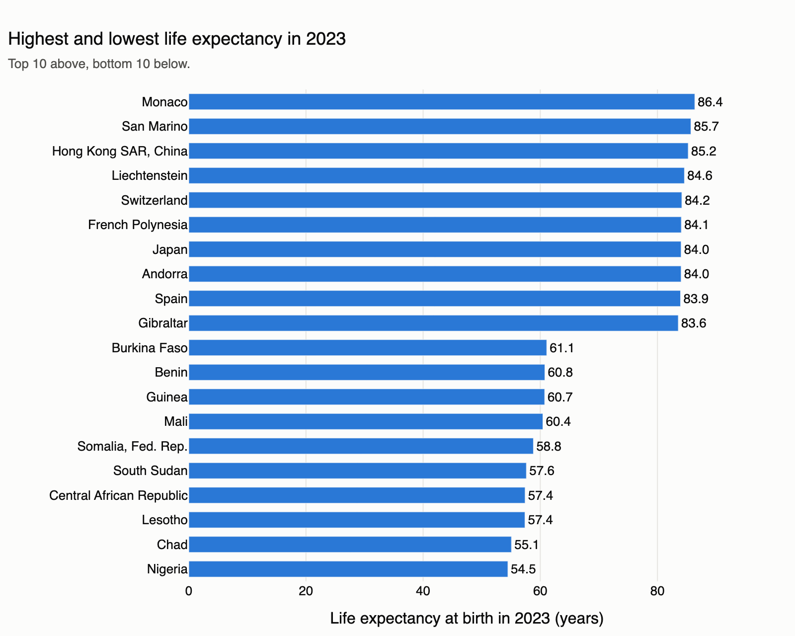
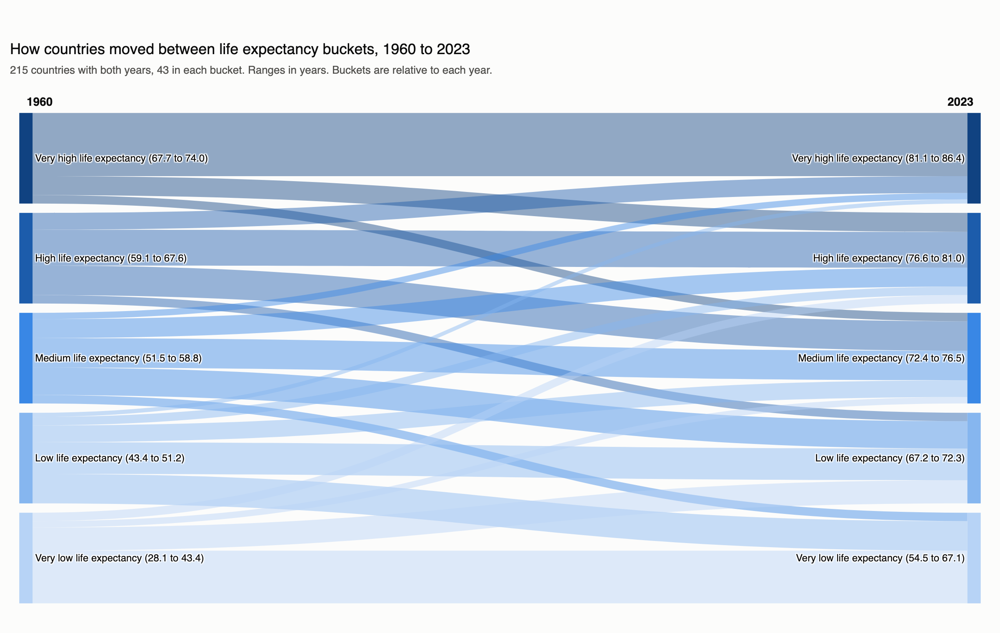
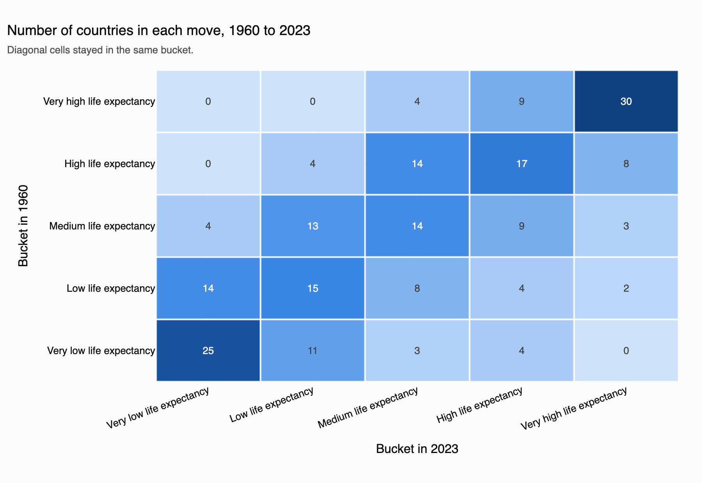

# Findings: life expectancy, 1960 to 2023

World Bank data for 217 economies, 1960 to 2023, downloaded on 2026-11-04. The World Bank reported a last update of 2026-10-08. Each section answers the assignment's question first, then says how the answer was calculated and what to watch out for.

To reproduce every number and chart, run `make data stats figures`. To explore them, run `uv run marimo run notebooks/01_statistics.py` or `uv run marimo run notebooks/02_charts.py`.

## 1. Statistical analysis

### Gender gap by income group

**For which income group has the difference in average life expectancy of men and women changed the most between 1960 and 2023?**

**Upper middle income**, at **+1.67 years**. On average, women's life expectancy was 4.26 years higher than men's in 1960 and 5.93 years higher in 2023.

| Income group | Gap in 1960 | Gap in 2023 | Change |
| --- | --- | --- | --- |
| Low income | 2.84 | 4.40 | +1.56 |
| Lower middle income | 3.20 | 4.74 | +1.54 |
| **Upper middle income** | **4.26** | **5.93** | **+1.67** |
| High income | 5.24 | 5.18 | -0.05 |

- **How:** the gap is women's life expectancy minus men's. For each income group and year, the gaps are averaged over every country with data, and each country counts once. The change is 2023 minus 1960.
- **Watch out:** the answer depends on the definition. Upper middle income leads low income by only 0.11 years.
  - If bigger countries count more, as in the World Bank's own group figures, lower middle income wins with +3.53. India, Pakistan, and Bangladesh had women living shorter lives than men in 1960.
  - Comparing 1960-62 with 2017-19, before COVID, low income wins with +1.82.
  - Using only countries with data in both years gives the same winner, at +1.67.
- **Watch out:** income groups are the World Bank's current labels, applied to every year. A country that is rich today counts as high income in 1960 too.

### Variability by income group

**For which income group has variability in life expectancy at birth changed the most between 1960 and 2023?**

**Upper middle income**, at **-3.77 years**. In 1960 its countries were spread far apart, from China at 33.4 to Ukraine at 69.4. In 2023 they were much closer, from Equatorial Guinea at 63.7 to Maldives at 81.0.

| Income group | Standard deviation in 1960 | Standard deviation in 2023 | Change |
| --- | --- | --- | --- |
| Low income | 6.76 | 4.60 | -2.16 |
| Lower middle income | 6.34 | 4.90 | -1.44 |
| **Upper middle income** | **7.55** | **3.78** | **-3.77** |
| High income | 6.91 | 4.18 | -2.73 |

- **How:** variability is the standard deviation of life expectancy across the countries in a group in one year, which is the typical distance of a country from its group's average. The change is 2023 minus 1960.
- **Variability fell in all four groups**, so countries within each group became more alike.
- **Checks:** upper middle income also wins on two other spread measures, the middle half of countries (IQR) and the gap between the highest and lowest country. It still wins without China, whose 1960 value is very low, and when starting from 1961, 1963, or 1965.
- **Watch out:** the coefficient of variation, which divides by the group's average, picks low income instead, because that average rose from a low base.

### Fertility and life expectancy

**Which countries have the highest correlation between fertility rate and life expectancy at birth over the years (either positive or negative)? Which countries have the lowest correlation?**

- **Highest:** **India** (-0.9973), then Brunei Darussalam (-0.9943), Ghana (-0.9937), Turkiye (-0.9916), and Turks and Caicos Islands (-0.9908).
- **Lowest:** **Belarus** (+0.0204), then Eswatini (+0.0400), Central African Republic (+0.0866), Congo, Dem. Rep. (+0.1228), and Ukraine (+0.1380).
- **Most positive:** Zimbabwe (+0.3452) and Lesotho (+0.3159).

- **How:** each country gets one Pearson correlation across its years. "Highest" means farthest from 0, either sign. "Lowest" means closest to 0.
- **Overall:** 208 of 217 countries are negative. As births per woman fell, life expectancy rose.
- **Watch out:** a strong correlation here does not show that one causes the other. Both changed steadily over the same decades, and any two steady trends look linked. Comparing each year's change instead removes most of that trend. India then falls from -0.9973 to -0.027, and the median across countries is -0.001.

## 2. Data visualizations

### Life expectancy by income group

Every group rose, and the poorest gained most. Low income went from 39.8 to 64.2 years (+24.4), and high income from 65.1 to 79.8 (+14.7). So the gaps between groups narrowed but did not close. The low income dip in 2009 comes largely from one country, Central African Republic.

### World map, 2023

Life expectancy is lowest in Sub-Saharan Africa and highest in Western Europe, East Asia, and Australia. The map has no shape for 3 places, Channel Islands, San Marino, and Kosovo, and the chart names them with their values.

Monaco is highest at 86.4 years, and Nigeria is lowest at 54.5.

### Moves between life expectancy buckets

The 215 countries with data in both years were ranked and split into five buckets of 43 each year. 101 stayed in the same bucket, 52 moved up, and 62 moved down. The biggest moves were the United Arab Emirates and Bahrain, from Low to Very high, and China, Iran, Maldives, and Oman, from Very low to High.

**Moving down does not mean getting worse.** No country has a lower value in 2023 than in 1960. Buckets compare countries within one year, and the highest value in 2023's Very low bucket (67.1) is about the lowest in 1960's Very high bucket (67.7). For example, Ukraine moved from Very high to Medium while rising from 69.4 to 73.4.

The same moves as exact counts. `reports/bucket_moves.csv` lists each country.

## 3. Forecast

To be added on Days 4 and 5.

## 4. Dashboard

To be added on Day 6.
